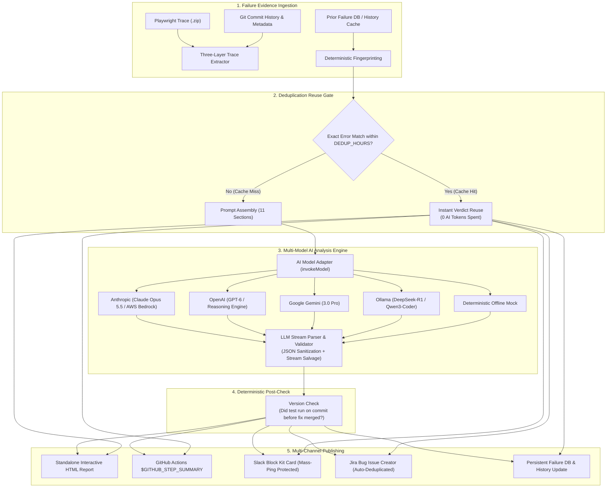

# 🔍 Autonomous Playwright Trace Analysis Pipeline

[](https://github.com/daniel-raj-s/playwright-trace-analysis-pipeline/actions/workflows/ci.yml)
[](https://opensource.org/licenses/MIT)
[](https://nodejs.org)
[](https://playwright.dev)
[](https://github.com/daniel-raj-s/playwright-trace-analysis-pipeline)

An enterprise-grade, company-agnostic autonomous failure investigation pipeline for **Playwright End-to-End (E2E) tests**. 

Designed for **GitHub Actions (GHA)** and local developer environments, this pipeline ingests Playwright trace archives (`trace.zip`), dissects deep DOM action wait timelines, reconstructs network waterfalls (detecting HTTP failures and silent GraphQL errors in HTTP 200s), captures failure screenshots, and invokes **any AI model** (OpenAI, Google Gemini, Anthropic Claude, Ollama, or an offline deterministic mock) to diagnose the root cause, identify the breaking commit or PR, and generate actionable fixes.

---

## 🏗️ System Architecture



---

## ✨ Key Features

### 1. 🔬 Investigation-Grade Trace Extraction
Follows a modular three-layer design:
- **`traceIo` Layer**: High-performance, streaming zip readers (`readJsonlMulti`) that concatenate segmented timeline logs (`*-trace.trace`, `*-trace.network`) across retries without extraction overhead.
- **`traceParse` Layer**: Pure, side-effect-free parser extracting:
  - **Action Timelines & Wait Logs**: Captures exact Playwright progress logs (`logTail`: *"waiting for locator... resolved to <button disabled data-testid='checkout'>"*).
  - **Failure Duration Interpretation**: Categorizes failure speeds into `TIMEOUT` (30s/60s budget exhaustion), `DETERMINISTIC` (<500ms strict-mode/absence), or `INTERMEDIATE` (race condition/DOM drift).
  - **Network Waterfall & GraphQL Inspection**: Detects status $\ge 400$, flags backend latency ($> 2000\text{ ms}$), and deep-inspects JSON response bodies for nested GraphQL errors (`errors[]` and `data.<Op>.errors[]` envelopes) returning HTTP 200.
  - **Noise Filtering**: Eliminates noise from React hydration warnings (`#418`, `#421`, `#422`, `#423`, `#425`), analytics, and tracking beacons.
  - **Failure-Moment Screenshot Scoping**: Clamps screenshot frames to the failure timestamp, filtering out subsequent teardown screenshots.

### 2. ⚡ Deterministic Deduplication (Zero-Token Reuse Gate)
- Computes an exact 200-character normalized error fingerprint (`createErrorFingerprint`) by normalizing newlines, stripping ANSI escapes, URLs, timestamps, duration strings, and memory addresses.
- If the same test failed with the exact same fingerprint within `DEDUP_HOURS`, the pipeline immediately serves the cached verdict, spending **0 AI tokens**.

### 3. 🌐 Universal Multi-AI Model Support
- Pluggable adapter (`invoke-llm.js`) supporting:
  - **Anthropic Claude**: `claude-opus-5-5`, `claude-sonnet-4-5`, `claude-3-7-sonnet` (Direct API & AWS Bedrock)
  - **OpenAI**: `gpt-6`, `gpt-5`, `o3`, `o4-mini`
  - **Google Gemini**: `gemini-3.0-pro`, `gemini-2.5-pro`, `gemini-2.5-flash`
  - **Ollama**: Local models (`deepseek-r1`, `qwen3-coder`, `llama3.3`) for air-gapped or private environments.
  - **Deterministic Mock**: Offline engine for CI verification without API credentials.

### 4. 🛡️ Robust Security & Safety Model
- **Read-Only LLM**: The AI model is strictly an analytical engine and is never given write access to external systems.
- **Deterministic Action**: All writes (Slack, Jira, GitHub PR comments) are executed by post-LLM deterministic code after schema validation.
- **Mass-Ping Neutralization**: Slack payload sanitizer automatically neutralizes `<!channel>`, `<!here>`, and `<!everyone>` into harmless text.
- **Credential Hygiene**: Tokens and keys are read exclusively from environment variables and never logged or printed.

---

## 🚀 Quick Start (Local CLI)

### 1. Clone & Install
```bash
git clone https://github.com/daniel-raj-s/playwright-trace-analysis-pipeline.git
cd playwright-trace-analysis-pipeline
npm install
```

### 2. Run Test Suite
```bash
# Run unit & integration tests
npm test

# Run MCP denylist and security checks
npm run denylist-check
```

### 3. Analyze a Playwright Trace
```bash
# Run with automatic AI provider detection (or offline mock if no keys are set)
node scripts/runner/run-pipeline.js --trace path/to/trace.zip --test tests/checkout.spec.ts

# With Anthropic Claude
export ANTHROPIC_API_KEY="sk-ant-..."
node scripts/runner/run-pipeline.js --trace path/to/trace.zip --provider anthropic --model claude-opus-5-5

# With OpenAI
export OPENAI_API_KEY="sk-..."
node scripts/runner/run-pipeline.js --trace path/to/trace.zip --provider openai --model gpt-6

# With Google Gemini
export GEMINI_API_KEY="AIza..."
node scripts/runner/run-pipeline.js --trace path/to/trace.zip --provider gemini --model gemini-3.0-pro-20250219

# With Local Ollama
node scripts/runner/run-pipeline.js --trace path/to/trace.zip --provider ollama --model llama3
```

---

## 🤖 GitHub Actions CI/CD Integration

Add this job to your existing Playwright test workflow:

```yaml
name: Playwright Test & Autonomous Analysis

on:
  push:
    branches: [main]
  pull_request:
    branches: [main]

jobs:
  e2e:
    runs-on: ubuntu-latest
    steps:
      - uses: actions/checkout@v4
      - uses: actions/setup-node@v4
        with:
          node-version: 20
          cache: 'npm'

      - name: Install dependencies
        run: npm ci

      - name: Run Playwright Tests
        id: run_tests
        run: npx playwright test
        continue-on-error: true

      - name: Upload Traces on Failure
        if: steps.run_tests.outcome == 'failure'
        uses: actions/upload-artifact@v4
        with:
          name: playwright-traces
          path: test-results/**/trace.zip
          retention-days: 7

  analyze-failures:
    needs: e2e
    if: always() && needs.e2e.result == 'failure'
    runs-on: ubuntu-latest
    permissions:
      contents: read
      pull-requests: write
      issues: write

    steps:
      - uses: actions/checkout@v4
      - uses: actions/setup-node@v4
        with:
          node-version: 20

      - name: Download Trace Artifacts
        uses: actions/download-artifact@v4
        with:
          name: playwright-traces
          path: traces/

      - name: Run Autonomous Trace Analysis
        env:
          OPENAI_API_KEY: ${{ secrets.OPENAI_API_KEY }}
          SLACK_BOT_TOKEN: ${{ secrets.SLACK_BOT_TOKEN }}
          GITHUB_TOKEN: ${{ secrets.GITHUB_TOKEN }}
        run: |
          npm ci
          node scripts/runner/run-pipeline.js \
            --trace traces/trace.zip \
            --provider anthropic \
            --model claude-opus-5-5 \
            --dedupHours 24

      - name: Upload Analysis Reports
        if: always()
        uses: actions/upload-artifact@v4
        with:
          name: analysis-report
          path: work-artifacts/**/report.html
```

---

## 📊 Output Artifacts

Every analysis run produces a comprehensive suite of artifacts in `work-artifacts/<test-slug>/`:

| Artifact | Purpose |
|---|---|
| `report.html` | Self-contained, responsive HTML report with collapsible cards, request inspector, and screenshot lightbox. |
| `summary.md` | Clean markdown report rendered automatically to GitHub Actions `$GITHUB_STEP_SUMMARY` and PR comments. |
| `analysis-result.json` | Strict JSON schema verdict for QE telemetry, dashboards, and automated triage systems. |
| `main-blocks.json` | Ready-to-post Slack Block Kit interactive card payload with triage buttons and screenshot previews. |

### Sample Structured Verdict Schema (`analysis-result.json`)
```json
{
  "classification": "real_bug",
  "confidence": "high",
  "casualSummary": "Checkout button remained disabled due to 502 Bad Gateway response on payment session endpoint.",
  "trigger": "GET /api/checkout/session responded with 502 Bad Gateway after 1250ms.",
  "failingAssertion": "tests/checkout.spec.ts:32 — toBeEnabled() exceeded 10000ms budget",
  "suggestedFix": "Verify payment gateway service health and add retry interceptor for transient 502 errors.",
  "existingFix": null,
  "ruledOut": "Client-side bundle error ruled out (no unhandled JS exceptions in window scope).",
  "suspectedPR": "#1042 (b4a8e21) by dev-author: Refactor payment session handler",
  "affectedComponent": "PaymentGatewayService",
  "chosenScreenshotFile": "trace0-page@a1b2c3d4-123456.png",
  "llmStats": {
    "provider": "anthropic",
    "model": "claude-opus-5-5",
    "duration_ms": 1180
  }
}
```

---

## 📁 Repository Layout

```
.
├── .github/
│   └── workflows/
│       ├── ci.yml                          # Continuous Integration & denylist checks
│       └── playwright-trace-analysis.yml   # Reusable GitHub Actions analysis workflow
├── prompts/
│   ├── analysis-prompt.md                  # 5-phase investigation system prompt
│   ├── fix-prompt.md                       # Test code fix generation prompt
│   └── question-prompt.md                  # Interactive QA prompt
├── scripts/
│   ├── context/
│   │   ├── fetch-jira-context.js           # Jira hints and search enrichment
│   │   ├── fetch-slack-context.js          # Slack thread context and outage signals
│   │   ├── jira-rest.js                    # Read-only Jira REST API module
│   │   └── run-version.js                  # Git SHA verification & fix PR comparison
│   ├── db/
│   │   ├── db-queries.js                   # Unified failure history & dedup engine
│   │   ├── insert-analysis-result.js       # UPSERT analysis verdict persistence
│   │   └── schema.sql                      # Production MySQL RDS schema
│   ├── llm/
│   │   ├── build-prompt.js                 # 11-section prompt builder with UTC time normalizer
│   │   ├── denylist-check.js               # MCP write-tool denylist regression tests
│   │   ├── invoke-llm.js                   # Universal adapter (OpenAI, Gemini, Claude, Ollama, Mock)
│   │   └── parse-llm-response.js           # JSON stream parser with partial output salvage
│   ├── notification/
│   │   ├── build-answer-blocks.js          # Interactive Slack question replies
│   │   ├── build-gha-summary.js            # GitHub Step Summary markdown generator
│   │   ├── build-html-report.js            # Standalone HTML report generator
│   │   ├── build-reuse-blocks.js           # De-duplication reuse card generator
│   │   ├── build-slack-blocks.js           # Main Slack Block Kit card generator
│   │   ├── file-jira-bug.js                # Jira bug creation with deduplication
│   │   ├── post-github-comment.js          # GitHub PR comment publisher
│   │   └── post-slack.js                   # Chokepoint Slack publisher with mass-ping defense
│   ├── runner/
│   │   └── run-pipeline.js                 # End-to-end 7-stage orchestrator
│   ├── trace/
│   │   └── extract-trace-failures.js       # Three-layer Playwright trace extractor
│   ├── utils/
│   │   └── fingerprint.js                  # Error fingerprinting & token Jaccard similarity
│   └── __tests__/                          # Offline unit & E2E integration test suite
├── package.json
└── README.md
```

---

## 📜 License

Distributed under the [MIT License](LICENSE). Copyright (c) 2026 Daniel Raj S.
